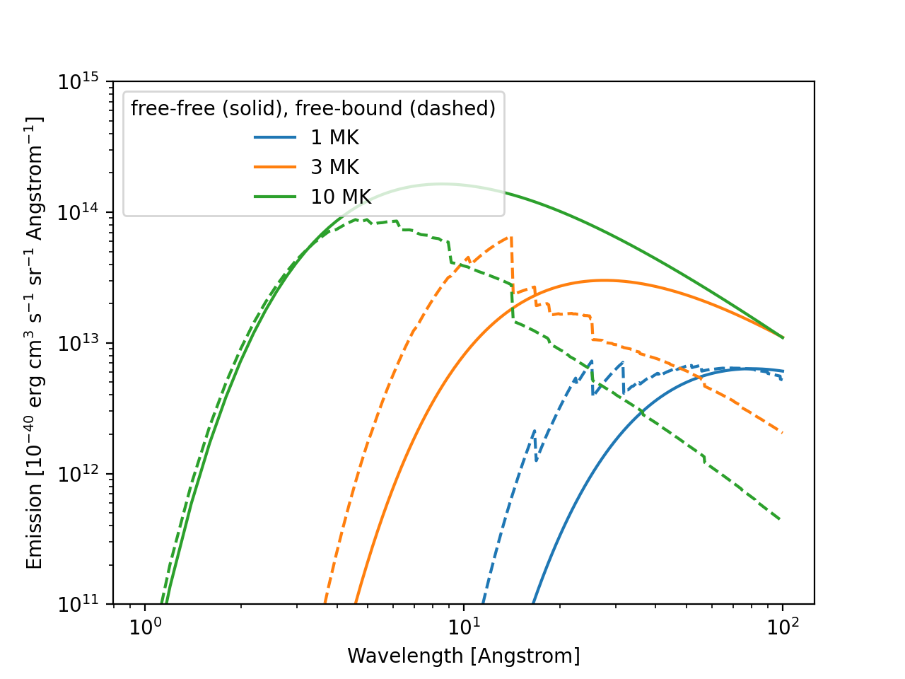

A hot, optically thin plasma emits a continuum made up mostly of free-free emission (bremsstrahlung) and free-bound emission. The [CHIANTI](https://www.chiantidatabase.org/) atomic database, which is distributed with SSW, has an IDL routine for each.

First, import the needed libraries.

```python
import astropy.units as u
import matplotlib.pyplot as plt
import numpy as np

import hissw
```

Next, write the IDL code. `freefree` and `freebound` take a list of temperatures and a list of wavelengths, which we inject from Python and convert to the units CHIANTI expects with the `to_unit` filter.

Both routines open a window asking for an abundance file unless one is passed, and nothing can answer it when IDL is run through hissw. CHIANTI defines `!abund_file` and `!ioneq_file` when SSW starts, so pass those.

```python
script = '''
temperature = {{ temperature | to_unit('K') }}
wavelength = {{ wavelength | to_unit('angstrom') }}
freefree, temperature, wavelength, free_free, abund_file=!abund_file, ioneq_file=!ioneq_file
freebound, temperature, wavelength, free_bound, abund_file=!abund_file, ioneq_file=!ioneq_file
'''
```

Set up the inputs with units, load the CHIANTI package, and run the script. `save_vars` returns only the two results.

```python
temperature = [1, 3, 10] * u.MK
wavelength = np.linspace(1, 100, 500) * u.angstrom
ssw = hissw.Environment(ssw_packages=['chianti'])
continuum = ssw.run(script, args={'temperature': temperature, 'wavelength': wavelength},
                    save_vars=['free_free', 'free_bound'])
```

Each result has one row per temperature and is in units of 10^-40 erg cm^3 s^-1 sr^-1 Angstrom^-1. Finally, plot both for each temperature,

```python
for i, t in enumerate(temperature):
    plt.plot(wavelength, continuum['free_free'][i], '-', color=f'C{i}', label=f'{t:.0f}')
    plt.plot(wavelength, continuum['free_bound'][i], '--', color=f'C{i}')
plt.xlabel('Wavelength [Angstrom]')
plt.ylabel(r'Emission [$10^{-40}$ erg cm$^3$ s$^{-1}$ sr$^{-1}$ Angstrom$^{-1}$]')
plt.xscale('log')
plt.yscale('log')
plt.ylim(1e11, 1e15)
plt.legend(title='free-free (solid), free-bound (dashed)', loc='upper left')
plt.show()
```

